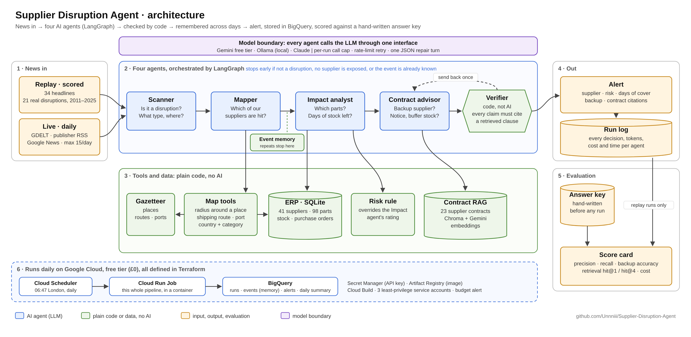

# Supplier Disruption Agent

[](https://github.com/Unnniii/Supplier-Disruption-Agent/actions/workflows/ci.yml)

An AI agent that reads the news, works out which suppliers a disruption hits, checks how many days of stock are left for their parts, and looks up the supplier contract for a backup plan.

It runs against the ERP of **Northgate Motors**, a fictional car maker with two UK plants and 41 suppliers. It has two modes:

- **Replay (scored):** 34 headlines, 21 of them real disruptions from 2011 to 2025 (Suez blockage, Renesas chip fire, Thailand floods, Tohoku earthquake, Shanghai lockdown, Red Sea attacks, Panama Canal drought, Baltimore bridge collapse, Hurricane Helene at Spruce Pine, Valencia floods, Typhoon Yagi, Hualien earthquake, China's rare earth magnet licences, the Nexperia chip export ban, the Oswego aluminium mill fire), plus non-events and deliberate traps. Every headline has a hand-written answer key, so accuracy is measured, not claimed.
- **Live (daily):** today's real headlines from GDELT, a free global news index, with publisher RSS feeds (BBC, Supply Chain Dive, FreightWaves, The Loadstar, gCaptain) and Google News as fallbacks, run through the same agents. Live results cannot be scored, because nobody has written the answer key for today.



> Status: two full scored runs on Gemini (results below), event memory across runs (10/10 on Gemini), 103 tests, CI on every push, and a daily scan deployable to GCP's free tier with one command (Terraform, Cloud Run Job, Cloud Scheduler, BigQuery). Every bug found along the way is logged in [docs/corrections.md](docs/corrections.md).

## The agents

| Agent | Job | Tools it can use | Output |
|---|---|---|---|
| **Scanner** | Is this headline a disruption? What type, where, which route or port? | none | `ScanResult` |
| **Mapper** | Which of our suppliers are exposed? | ERP lookups: suppliers near a place, on a shipping route, using a port, or in a country and category (for export controls) | `MapResult` |
| **Impact analyst** | How bad is it? Days of stock cover, critical parts, vehicle models | parts and stock, open purchase orders | `ImpactResult` |
| **Contract advisor** | What does the contract say? Backup supplier, notice period, buffer stock | contract search (RAG) | `AdviceResult` with citations |
| **Verifier** | Are the advisor's claims backed by clauses it actually retrieved? | plain code, no LLM | approve, send back once, or flag for review |

Each agent has its own instructions, its own tools and its own output schema. An agent only sees the tools it needs, so the Scanner cannot query the ERP and the Mapper cannot read contracts.

## Orchestration (LangGraph)

```text
scanner --(not a disruption)------------------------------> END
   |
mapper  --(no supplier exposed)---------------------------> END
   |
events  --(known event, nothing new: "ongoing")-----------> END     no model call; live and --sequence runs
   |
impact -> advisor -> verifier --(issues, first time)--> advisor
                         |
                         +--(approved, or out of revisions)--> END
```

- Early exits keep cost down: in the answer key, 14 of the 34 headlines should stop after the Scanner or Mapper.
- The Mapper can only report suppliers the ERP tools returned; invented IDs are dropped.
- The math is not done by the LLM. Distances, radii and days of cover are plain Python and SQL. The Impact agent's risk rating is re-checked against the rule in code; the rule wins and disagreements are logged.
- If an agent returns invalid JSON it gets one repair turn with its own error message before the headline is marked `error`.
- A failing agent marks that headline `error` and the batch carries on.
- Every headline is logged to `logs/runs.jsonl` with each agent's tokens, tool calls, time and cost.

## Event memory: alert on what changed, not on every headline

Without memory, five articles about one port strike are five alerts, every day the strike lasts. The first live cloud run showed it: an article about *ongoing* Red Sea risk flagged 15 suppliers as if it were news. `agent/events.py` adds state that lasts between runs.

| Decision | When | What happens |
|---|---|---|
| **new** | no open event matches | full analysis, alert |
| **escalated** | known event, but a new supplier is exposed or severity went up | full analysis, alert, says what changed |
| **ongoing** | known event, nothing new | stops after the Mapper: no Impact, Advisor or Verifier calls, no alert |
| **resolved** | not reported for 14 days | closed; a later report starts a new event |

**Who decides what.** The LLM agents extract *what* happened and *where*, and the ERP tools say *which suppliers* are exposed. Whether two reports are the same event is decided in plain code, so it is repeatable and testable.
- **Same event** if within 14 days and either:
  - exposed suppliers overlap by at least 60% (Jaccard), or
  - they share a place, route, port or country *and* either the same hazard family or a shared supplier.
- **Escalated** (alert again) if:
  - a supplier is exposed that was not before, or
  - severity jumps two levels (low → high), or
  - a new hazard family appears (a flood after a fire at the same plant).
- **Otherwise ongoing:** no alert.

**Why the rules lean on suppliers, not labels.** A model calls the same flood "flood" one day and "severe_weather" the next, and "medium" then "high". So label changes *within* a hazard family (shipping, weather, fire and so on) are treated as noise, and a one-level severity change is ignored. Supplier exposure comes from the ERP, so it is the stable signal. A test reruns the whole sequence with labels flipping and severity wobbling the way a real model's do; the decisions do not change.

**Commit after success.** A decision enters memory only once its headline is fully handled, and memory is saved only *after* the alerts are stored in BigQuery. If storing the alerts fails, the job fails and the events stay unseen, so they alert again next run. A test forces that failure and checks that nothing is saved.

**Storage.** On a laptop: `data/events.json`. In the cloud: a BigQuery `events` table. It is read once at the start of a run (free table read) and rewritten once at the end (free load job), because the container's disk is wiped after every run. One scan runs at a time, so there is no locking.

**Scored replays are unaffected.** The 34-headline evaluation runs without memory, so each headline is still judged on its own.

**How it is tested.** `eval/event_sequence.json` holds 10 headlines in date order, each with the decision it should get. The cases cover:
- a repeat
- risk commentary about a known event
- an unrelated event on the same days
- a strike whose suppliers are a subset of the Red Sea set (6 of 15, which must *not* merge)
- a flood that spreads to a second supplier (escalation)
- the same route 44 days later (a new event)

```bash
uv run python -m agent.run --sequence --fake    # or without --fake for Gemini
uv run python -m agent.evaluate                 # scores the event decisions
```

| | Gemini (`gemini-3.1-flash-lite`) | Stand-in model (`--fake`) |
|---|---|---|
| Event decision right | **10 / 10** | 10 / 10 |
| Alerts sent | **6** (without memory: 10) | 6 (without memory: 10) |
| Model calls for a repeat (ongoing) | **about 4**, vs about 9 for a new event | 3 vs 7 |
| Model calls, whole sequence | 71 | 54 |

On Gemini the Taipei → Taichung escalation matched on *same place* ("taipei, taiwan"), not supplier overlap, which is the path the label-noise fix protects. The insurance-cost article (risk commentary about a known event) was correctly treated as ongoing: no alert.

The matching rules are also covered by unit tests in `tests/test_events.py`.

## Models and cost: built to run for £0

| `SDA_PROVIDER` | Model | Cost | Use it for |
|---|---|---|---|
| `gemini` (default) | Gemini 3.1 Flash-Lite + Gemini Embedding 2, via Google AI Studio | free tier | normal runs and evaluation |
| `ollama` | any local model, e.g. `qwen3:8b` | free, runs on your laptop | no-quota, fully offline runs |
| `claude` | Claude Haiku 5.5 | paid | comparison only |
| `fake` / `--fake` | rule-based stand-in | free | tests and CI |

Switching provider is a setting, not a code change: every agent talks to one `LLM` interface and each adapter translates to its own API (`src/agent/llm.py`). The tool-use loop is ours on every provider, so logging, the cap and error handling behave the same everywhere.

**The cap.** Every run is wrapped in `CappedLLM`. After `SDA_MAX_LLM_CALLS` model calls (default 300) the run stops cleanly and nothing else is spent. Per-minute `429` rate limits and `503` overloads are retried with backoff. A *daily* quota `429` (the Gemini free tier allows about 500 requests per model per day) is not retried: the run stops at once and tells you when it resets. Either way, `uv run python -m agent.run --resume` later finishes only the unfinished headlines under the same run id, so `agent.evaluate` scores one complete run. Contract embeddings are computed once and stored in Chroma, so re-runs do not spend embedding quota.

**Free-tier caveats, stated plainly.** Google may use free-tier inputs to improve its products; all data in this project is fictional, so that is acceptable here. Google's terms restrict the free tier for apps *serving* users in the UK and EEA; this repo is a personal demo, and `ollama` is the fully local alternative.

## The data

`scripts/seed_erp.py` builds `data/erp.db` (SQLite) with fixed random seeds. Suppliers S031 to S041 were added later from their own random stream, so the data for S001 to S030 is unchanged and earlier runs stay comparable (a test checks this).

| Table | Rows | What it holds |
|---|---|---|
| `plants` | 2 | Midlands Assembly, Merseyside Assembly |
| `suppliers` | 41 | location (lat/lon), category, tier, origin port, shipping route, UK port of entry |
| `parts` | 98 | part, supplier, cost, lead time, critical flag, vehicle models it goes into |
| `inventory` | 148 | stock on hand, daily usage, safety stock, per part per plant |
| `purchase_orders` | 98 | open orders with route, port and ETA |

Other inputs:

- `data/news.json`: 34 headlines (21 real past disruptions, 13 non-events or traps)
- `data/contracts/`: 23 supplier contracts (backup supplier, force majeure notice, buffer stock, freight terms)
- `data/gazetteer.json`: place names to coordinates, shipping routes, route aliases (the Red Sea is the Suez lane), ports

## The answer key

`eval/ground_truth.json` is written by hand, not generated by the agent. For every headline it lists which suppliers must be flagged, which are acceptable extras, and why. Traps it tests:

- A factory fire in Hitachinaka must not flag the pigment plant 75 km away
- The Shanghai lockdown must not flag the Ningbo supplier (different city, different port)
- The Suez blockage and Red Sea attacks must not flag the Penang supplier (ships via the Cape)
- China's rare earth magnet licences hit the two magnet suppliers, not every supplier in China
- The Baltimore bridge collapse is found through the port, not by distance: the bearing supplier is 75 km away in Pennsylvania
- The Hualien earthquake hits Hsinchu Silicon **and its own backup** in Taichung
- "Nakagawa" is not "Hitachinaka"; a heatwave in Valencia with "no closures" is not a disruption, but the 2024 Valencia floods are

`eval/rag_questions.json` holds 14 contract questions with the contract that should be retrieved.

## Evaluation

```bash
uv run python -m agent.run            # full replay, 34 headlines
uv run python -m agent.evaluate       # score it
```

`agent.evaluate` scores the latest run and writes `eval/results.md`, and appends one line to `eval/history.jsonl` so before/after comparisons are a diff, not a memory.

| Check | How it is scored |
|---|---|
| Scanner | disruption or not, against the key |
| Mapper | precision and recall of flagged suppliers; acceptable extras are neither rewarded nor punished |
| Advisor | backup supplier and coverage (full / partial / none) against the contracts |
| Contract search | right contract ranked first, and in the top 4, for 14 questions (hit@1, hit@4, MRR) |
| Pipeline | verifier send-backs, rule corrections, JSON repairs, errors, tokens, cost, time |

**Results** (Gemini `gemini-3.1-flash-lite`, free tier, all 34 headlines, temperature 0):

| What | Before (run `f986f123`) | After (run `6d053935`) |
|---|---|---|
| Headlines fully right | 34 / 34 | 34 / 34 |
| Scanner accuracy | 100% | 100% |
| Supplier precision / recall | 100% / 100% | 100% / 100% |
| Backup supplier named correctly | 100% of 51 | 100% of 51 |
| Backup coverage correct | 92% of 51 | 94% of 51 |
| Backups hit by the same event | 13, **all 13 with no warning** | 13, **0 with no warning** |
| Contract search hit@1 / hit@4 (MRR) | 79% / 100% (0.893) | 79% / 100% (0.893) |
| Impact ratings corrected by the rule | 2 | 2 |
| Tokens per headline | 8,168 | 8,358 |
| Cost | $0 | $0 |

**How to read this honestly.**
- The answer key has 34 headlines and was written by the builder of the system, so a perfect mapping score shows the tools work, not that the system generalises. It needs harder and more numerous cases.
- The interesting result is the row the original score did not measure. The first full run scored 34/34 and still recommended, for example, a Taiwanese backup for a Taiwanese supplier in a Taiwan earthquake. Every one of those 13 recommendations was "correct" against the contracts. A deterministic check now flags them, and the evaluation counts them.
- The remaining coverage errors are inconsistency, not ignorance. The same contract (S002 → S012, and S027 → S026) gets "full" on one headline and "partial" on another. The next fix is to let code read coverage from a structured contract field instead of asking the model each time.
- The after run was split in two by the free tier's daily quota (500 requests per model) and finished with `--resume` under the same run id.

The offline keyword stand-in (`--fake`) gets 32 of 34 headlines fully right. That is the floor a real model has to beat.

## Live mode

```bash
uv run python -m agent.run --live                 # last 24 hours, up to 15 headlines
uv run python -m agent.run --live --max-live 30
```

Three free sources, tried in order:
1. GDELT, a global news index searched with disruption keywords.
2. Publisher RSS feeds (BBC World and Business, Supply Chain Dive, FreightWaves, The Loadstar, gCaptain), filtered to recent, disruption-sounding headlines.
3. Google News RSS.

A source that refuses, or answers with nothing, hands over to the next. From Cloud Run, GDELT (429) and Google News (503) both turn away data-centre traffic, so the cloud scan normally runs on the publisher feeds. Each headline records which source it came from. Headlines are de-duplicated, capped and saved to `data/live/`, so every alert can be traced back to what was read. All three give titles, not article text, so the Scanner judges from the headline. Most days nothing touches 41 fictional suppliers, so "no exposure" is the normal answer.

```bash
uv run python -m agent.live                                      # just fetch and print, no model calls
$env:SDA_LIVE_SOURCE="feeds"; uv run python -m agent.live        # force one source (PowerShell)
```

**Daily on Windows:** `scripts/run_daily.ps1` runs the live scan and appends to `logs/daily.log`. Register it with Task Scheduler using the command at the top of that file.

## Cloud: daily scan on GCP (free tier)

```
Cloud Scheduler (06:47 London, daily)
        |  POST .../jobs/sda-daily-scan:run   (as sda-scheduler, run.invoker only)
        v
Cloud Run Job  sda-daily-scan   (container from Artifact Registry, runs as sda-job)
        |  news (GDELT -> publisher RSS -> Google News) -> Scanner -> Mapper -> Event memory -> Impact -> Advisor -> Verifier
        |  Gemini key from Secret Manager
        v
BigQuery  supplier_disruption.runs   one row per headline, partitioned by day
          supplier_disruption.events event memory: read at start, rewritten at end of each run
          views: alerts (what touched our suppliers), daily_summary (read / flagged / errors / tokens / cost)
```

Everything is in Terraform (`infra/`). The image is built by Cloud Build (`cloudbuild.yaml`). `scripts/deploy_gcp.ps1` does the whole deployment in one command.

**First live cloud run** (12 October 2026, 15 real headlines from publisher feeds; GDELT and Google News refused Cloud Run's IPs): 7 judged disruptions, 2 alerts, 0 errors, 81,094 tokens, $0. Both alerts are debatable. "Shippers stressing over risks from Suez Canal and Red Sea transits" flagged all 15 Suez-route suppliers, but it describes an ongoing risk, not a new event. A Mexican trucker shortage was labelled an export control. Traps were handled: "BD strikes supply chain pact" was rejected, and Hormuz tanker attacks were judged real but with no supplier exposed. The answer key has no "risk commentary versus actual event" cases. This run is why event memory exists (see below): a repeat of a known situation is no longer re-alerted.

**Design choices**
- **A Job, not a Service.** A scan is a batch: it starts, runs for a few minutes and exits. Nothing sits idle and nothing is publicly reachable.
- **Batch load jobs into BigQuery, not streaming inserts.** One load job per run. Load jobs are free; streaming is billed per row.
- **The API key never touches Terraform state or the image.** Terraform creates an empty secret, and the deploy script adds the key as a secret version.
- **Three service accounts with narrow roles.** The build can only push images and write logs. The job can only read its one secret and write to its one dataset. The scheduler can only start this job.
- **Quota safety.** The job uses `max_retries = 0` and the scheduler retries 0, so a failure never spends the free model quota twice. The per-run call cap is 150 (the free tier allows about 500 a day), and a daily-quota error stops the run cleanly.
- **Reproducible deploys.** The job runs the image pinned by digest, not `:latest`. A registry cleanup policy keeps 2 images, to stay inside the 0.5 GB free storage.
- **A budget alert** at 50%, 90% and 100% of £1 a month. It warns; it does not stop spending.
- **Region `us-central1`,** because the Cloud Run free tier only covers some US regions. A real UK deployment would use `europe-west2` for data residency and pay a little for it.

**Why it stays at about £0** (free allowances per month at the time of writing; check the [Google Cloud free tier](https://cloud.google.com/free) before relying on them)

| Service | Free allowance | This project |
|---|---|---|
| Cloud Run | 180,000 vCPU-seconds, 360,000 GiB-seconds | about 30 runs × a few minutes |
| Cloud Scheduler | 3 jobs per billing account | 1 |
| Cloud Build | 2,500 build-minutes | about 5 minutes per deploy |
| Artifact Registry | 0.5 GB | one image of about 0.2 GB compressed, 2 kept |
| BigQuery | 10 GiB storage, 1 TiB queries; load jobs free | a few MB |
| Secret Manager | 6 secret versions, 10,000 accesses | 1 version, 30 accesses |
| Gemini API | free-tier daily request limit | 150 calls at most per run |

The laptop and the cloud job share one Gemini key, and so one daily quota. Don't run the full 34-headline evaluation on a day you also need the cloud scan.

**Deploy** (Windows PowerShell, from the project folder). GCP needs a billing account with a card even for free-tier use.

```powershell
winget install Google.CloudSDK
winget install Hashicorp.Terraform
# close and reopen PowerShell
gcloud auth login
gcloud auth application-default login
.\scripts\deploy_gcp.ps1 -ProjectId <your-project-id> -BillingAccount <XXXXXX-XXXXXX-XXXXXX>
```

The script runs the job once and prints what landed in BigQuery. After that it runs every morning on its own. Useful afterwards:

```powershell
gcloud run jobs execute sda-daily-scan --region us-central1 --wait      # run now
bq query --use_legacy_sql=false "SELECT * FROM supplier_disruption.alerts LIMIT 20"
```

**Tear down:** `terraform -chdir=infra apply -var project_id=<id> -var protect_data=false`, then `terraform -chdir=infra destroy -var project_id=<id>`. Deleting the project also works.

**Not done yet:** an alert when the job fails (today you see it in the Cloud Run console), Terraform state in a GCS bucket rather than on the laptop, and deploys from GitHub Actions through Workload Identity Federation (no stored keys).

## Run it

```bash
uv sync
uv run python scripts/seed_erp.py
uv run pytest                                   # 103 tests, offline, free
uv run python -m agent.run --fake               # whole pipeline with a rule-based stand-in model
cp .env.example .env                            # add GEMINI_API_KEY (free, aistudio.google.com/apikey)
uv run python -m agent.run --news N01 N07       # try two headlines first
uv run python -m agent.run                      # full scan, Gemini free tier
SDA_PROVIDER=ollama uv run python -m agent.run  # local model instead (install Ollama, `ollama pull qwen3:8b`)
uv run python -m agent.evaluate                 # score the latest run
uv run python -m agent.run --sequence           # event-memory test (10 ordered headlines), then evaluate again
uv run python -m agent.run --live               # today's real headlines, with event memory
uv run python -m agent.run --resume             # finish a run the daily quota cut short
```

Contract search uses Gemini embeddings when `GEMINI_API_KEY` is set, otherwise Chroma's local embedding model, otherwise keyword (BM25) search, and prints which one it fell back to.

**What the tests cover:** the evaluation maths, live news parsing and fallback, the new country and route-alias tools, that adding suppliers left old data unchanged, the cap, the Gemini and Ollama adapters (with stand-in clients, no network), data integrity, the Map step reaching the answer key, routing and early exits, the tool loop's turn limit and unknown-tool handling, the verifier's checks, the advisor revise loop, failure isolation, event memory (matching rules, label noise, save order, BigQuery store), the BigQuery writer and schemas, and UTF-8 file handling for Windows.

**`--fake` mode is a floor, not a result.** It is keyword matching that never reads the answer key. It exists so the pipeline can be tested without cost. Real accuracy numbers come from the evaluation on Gemini.

## Known gaps (honest list)

- The verifier checks that a cited clause names the backup, not that the backup is in the right direction. For example, Taichung's contract names Hitachinaka because Taichung is Hitachinaka's backup. A model could misread that as "Hitachinaka is Taichung's backup" and pass the check.
- When the Scanner names both a country and a city, a wide radius (war: 600 km) from the city can catch suppliers in neighbouring countries. The evaluation will show how often this happens.
- Event memory stops *repeat* alerts, but the first article about a long-running risk still alerts once. Telling "risk commentary" apart from "new event" on first sight is not solved.
- Event matching uses fixed thresholds (14 days, 60% overlap) chosen by hand, not tuned on data.
- Coverage (full / partial / none) is judged by the model on every headline, so the same contract can get different answers on different days (S002 and S027 in the results above).
- The Ollama path is tested with stand-ins only. The Gemini path has two full scored runs.
- Live sources are unit-tested against recorded replies; the real feeds are only exercised by the daily cloud run and manual laptop runs. If a publisher changes its RSS address, that source fails quietly and the next one is used. The logs show it, but nothing alerts on it.
- The answer key was written by the same person who built the system. An independent second annotator would make the scores more trustworthy.
- Gemini model names change; if `gemini-3.1-flash-lite` returns 404, set `SDA_MODEL` to the current Flash-Lite name shown in AI Studio.

## Roadmap

- [x] Day 1: fake ERP, news, contracts, answer key, deterministic tools, tests
- [x] Day 1: RAG over contracts, four agents + verifier, LangGraph orchestration, run logs
- [x] Free model backends (Gemini free tier, Ollama) and a per-run call cap
- [x] Evaluation script: precision, recall, backup accuracy, retrieval hit rate, cost
- [x] 11 more suppliers and 14 more headlines from real 2023 to 2025 disruptions
- [x] Live mode (GDELT, publisher RSS, Google News, with fallback) and a daily Windows schedule
- [x] Full scored run on Gemini; results in this README
- [x] Fix the worst miss and re-run (before/after numbers): unsafe backups warned 0 of 13 → 13 of 13
- [x] Event memory: new / escalated / ongoing / resolved, stored in BigQuery, 10/10 on Gemini on a scored sequence
- [ ] Coverage as a structured contract field read by code, not judged by the model
- [ ] Evaluation as a CI gate: fail the build if precision, recall or event decisions get worse
- [ ] Parallel advisor per supplier (LangGraph `Send`), and tiered model routing
- [ ] Streamlit app, demo GIF
- [x] GCP deployment at £0: Cloud Run Job + Cloud Scheduler + BigQuery, Terraform, budget alert, CI
- [ ] Failure alerting, remote Terraform state, keyless deploys from GitHub Actions
- [ ] Real geocoding instead of the gazetteer
